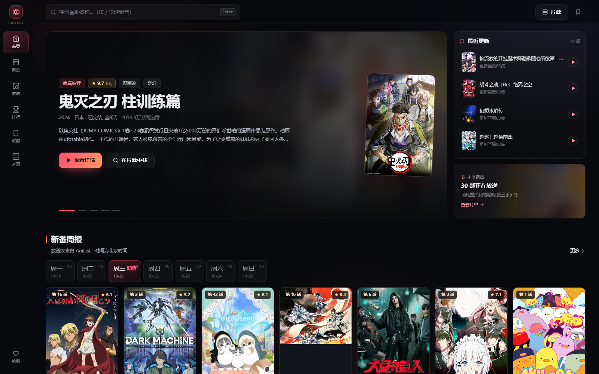
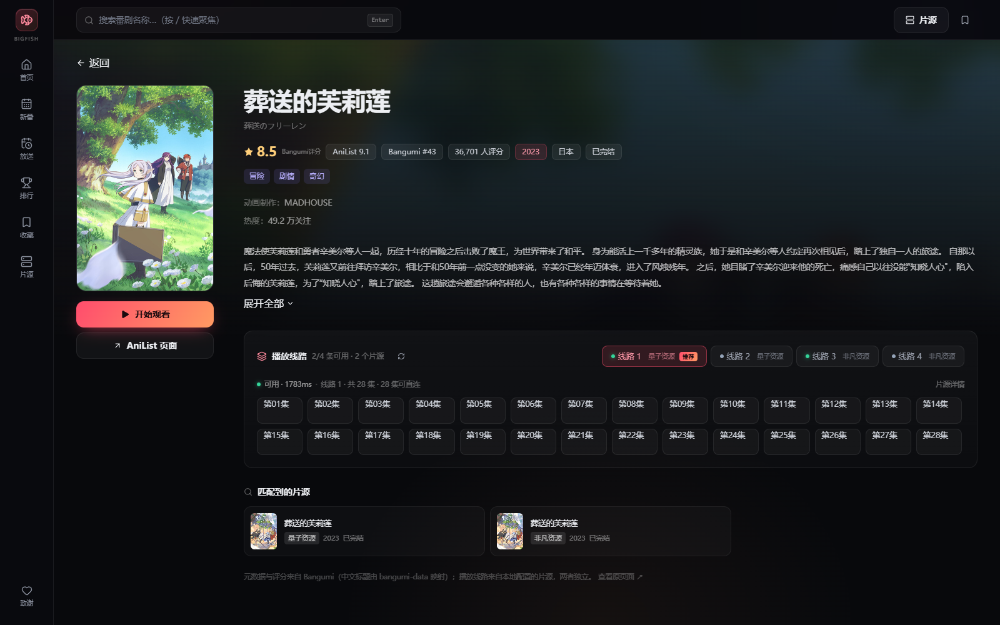
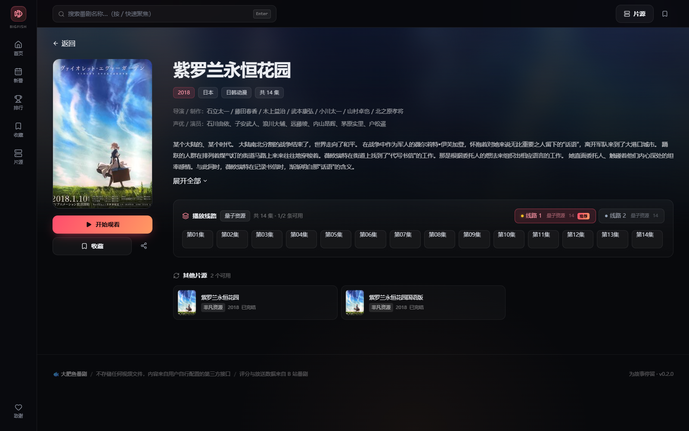
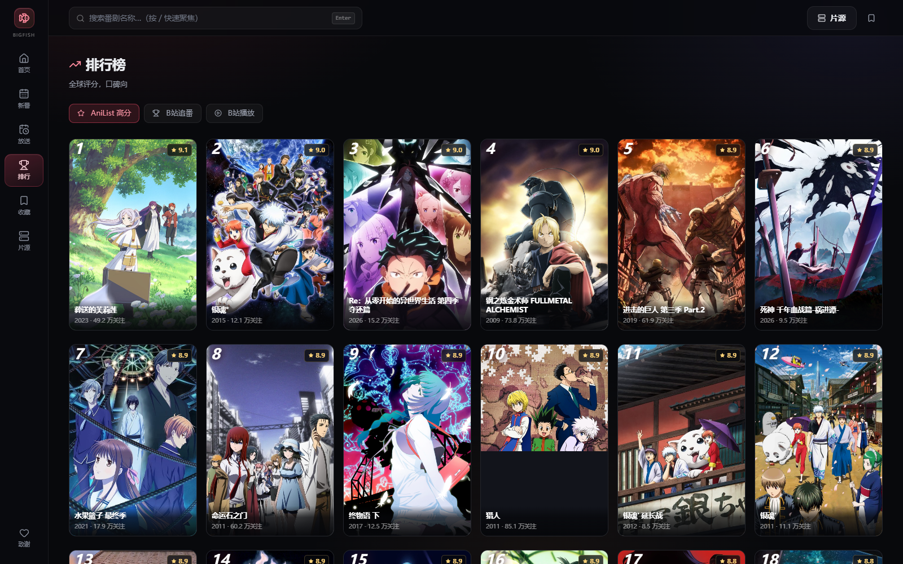
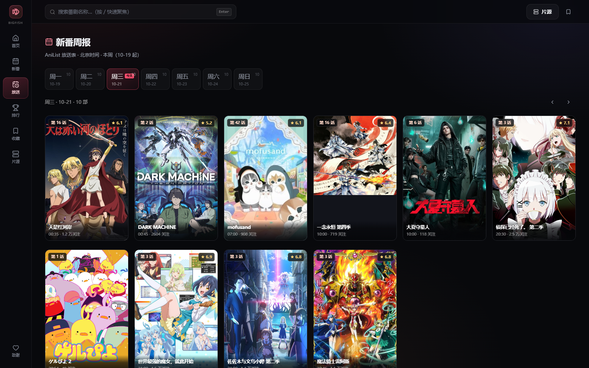
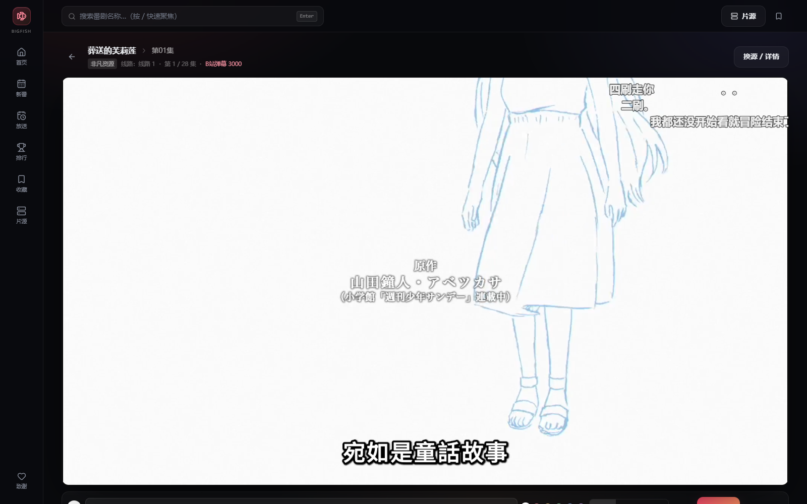
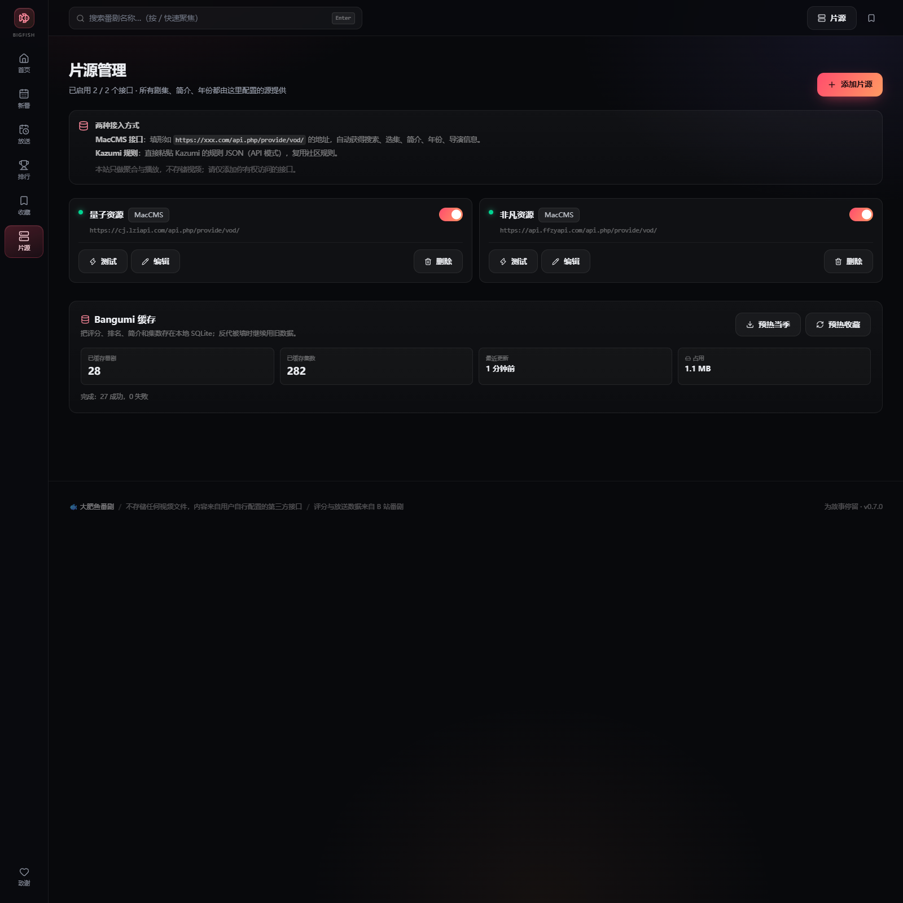
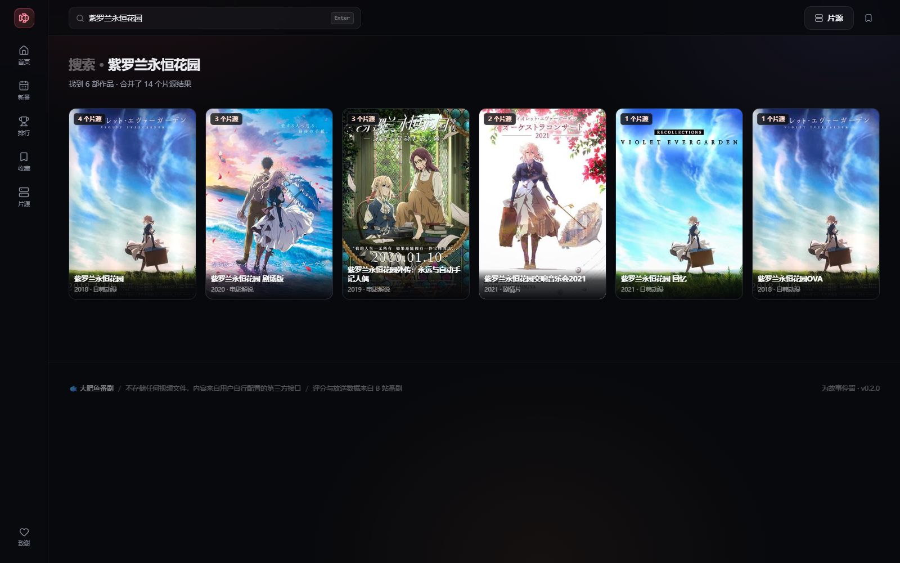
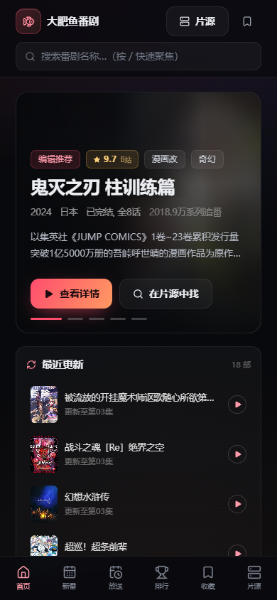

# 🐟 大肥鱼番剧 · BigFish Anime

> 跑在自己电脑上的动漫聚合播放站。**发现层看评分和热度，播放层用你自己的片源**；线路收进详情页，首页只负责把「该看什么」讲清楚。



---

## 目录

- [这次改了什么](#这次改了什么)
- [首页的分层逻辑](#首页的分层逻辑)
- [功能](#功能)
- [快速开始](#快速开始)
- [页面](#页面)
- [数据从哪来](#数据从哪来)
- [播放线路：现状与继续加线路的思路](#播放线路现状与继续加线路的思路)
- [播放链路](#播放链路)
- [弹幕与评论](#弹幕与评论)
- [项目结构](#项目结构)
- [技术栈](#技术栈)
- [接口一览](#接口一览)
- [已知限制](#已知限制)
- [参考与致谢](#参考与致谢)
- [免责声明](#免责声明)

---

## 这次改了什么

v0.1 是「多源搜索 + 播放器」，v0.2 重做首页与线路，v0.3 补线路健康检查，v0.4 补「记住线路 + 真实成功率 + 强制重检」，v0.5 把新番/评分/周表切到 **AniList + bangumi-data 中文映射**，v0.6 接通 **Bangumi 评分与中文简介**，v0.7 加 **SQLite 缓存** 防反代被墙，v0.8 接 **B站弹幕**：

1. **首页有主次**：Hero 大图 + 右侧「最近更新」+「本季新番」+「高分好评」+「最近更新」+「大家都在追」，不再是所有片源平铺。
2. **评分和热度变成主轴**：接入 B 站番剧数据（评分、追番数、在播列表、简介、声优、制作），首页先看口碑和热度，再决定点哪部。
3. **源退到线路里**：卡片不再标「量子资源 / 非凡资源」；点进番剧后，播放线路才出现「线路 1 · 量子 / 线路 2 · 非凡」，同一部番的不同源会被合并成可选线路。
4. **线路会自己体检**：绿/黄/红/灰状态点、「推荐」徽标、自动切到最快可用线路，不再盲点死链。

| 番剧详情（元数据优先） | 线路选择（跨源 + 健康检查） |
| --- | --- |
|  |  |

| 排行榜 | 新番周报 |
| --- | --- |
|  |  |

| 播放器 + 弹幕 | 片源管理 |
| --- | --- |
|  |  |

| 搜索 | 移动端 |
| --- | --- |
|  |  |

---

## 首页的分层逻辑

```
┌ 左侧图标栏 ─┐  ┌─────────────── Hero（今日主推） ───────────────┐  ┌── 最近更新 ──┐
│ 首页        │  │  评分 · 类型 · 年份 · 简介 · 查看详情 / 找片源   │  │  4 条片源更新  │
│ 新番        │  │              [封面卡]                          │  ├── 本季新番 ──┤
│ 排行        │  └────────────────────────────────────────────────┘  │  30 部在播     │
│ 放送        │  ┌── 新番周报（周一～周日 tabs） ──────────────────┐  └───────────────┘
│ 收藏        │  │ AniList 放送表 · 每天 10 部 · 北京时间            │
│ 片源        │  ├── 本季新番（横向） ────────────────────────────┤
└────────────┘  │ AniList 评分 / 中文标题 / 关注度                 │
                ├── 高分好评（横向） ────────────────────────────┤
                ├── 最近更新（来自你的片源，不标源名） ──────────────┤
                └── 大家都在追（B 站追番榜，按系列去重） ───────────┘
```

- **一级信息**：Hero 大图、评分、在播/完结、简介、主按钮。
- **二级信息**：新番周报、本季新番、高分榜、最近更新、B 站热度，用来「逛」。
- **三级信息**：源名、线路名、片源画质，只在详情页/播放页出现。

> 数据分工：**AniList 负责新番/评分/周表，B 站负责中文热度，Bangumi 的中文标题通过离线 `bangumi-data` 映射**。B 站放送表每天只有 1–2 部有效番剧，所以不再用它做周表。

---

## 功能

### 发现（AniList + B 站）

- [x] 首页 Hero：B 站热门口碑，评分、类型、年份、简介、封面卡、自动轮播
- [x] **本季新番**：AniList 当季 30 部，中文标题优先，按关注度/评分排序
- [x] **新番周报**：AniList 周一～周日放送表，每天最多 10 部，北京时间
- [x] **高分好评**：AniList 全球评分榜（0–100 折成 10 分制）
- [x] 大家都在追：B 站追番榜，按系列去重（中文热度）
- [x] 排行榜页：AniList 高分 / B 站追番 / B 站播放
- [x] 番剧详情：AniList/B 站评分、简介、声优、动画制作、放送状态、类型标签
- [x] 中文标题：`bangumi-data` 离线种子（8,900+ 条，AniList ID + 标题双向映射）

### 播放（你的片源）

- [x] 多 MacCMS 接口并行搜索，同名作品自动合并
- [x] **跨源线路合并**：B 站详情页自动在片源里找同名作品，生成「线路 1 / 2 / 3 …」
- [x] **线路健康检查**：绿/黄/红/灰状态点 + 延迟，10 分钟缓存
- [x] **自动选线**：按可用性、真实成功率、延迟、可直连集数自动选最优；手动点过就不再覆盖
- [x] **记住上次线路**：按作品存 localStorage，下次进详情优先恢复
- [x] **强制重检**：标题旁刷新按钮，跳过 10 分钟缓存
- [x] 每条线路标注来源片源、集数、可直连集数
- [x] 线路切换、选集、换源、片源详情互跳
- [x] HLS / MP4，服务端代理解决 CORS、Referer、混合内容
- [x] 非直链播放页自动嗅探 m3u8 / mp4
- [x] 自定义播放器：进度、音量、倍速、画质、画中画、全屏、下一集
- [x] 快捷键：`空格`、`←/→`、`↑/↓`、`F`、`M`
- [x] 断点续播：每 10 秒记录，首页「继续观看」
- [x] 观看记录 / 收藏

### 互动

- [x] 弹幕：滚动 / 顶部 / 底部、颜色、透明度、字号、开关，Canvas 渲染
- [x] **B站弹幕导入**：B站番剧详情进入播放器时自动加载，最多 3000 条，6 小时文件缓存
- [x] 评论：昵称、正文、回复（`parentId`）、时间
- [x] 数据本地持久化，随时可接 WebSocket

---

## 快速开始

### 环境要求

| 依赖 | 版本 | 说明 |
| --- | --- | --- |
| Node.js | **20.19+ / 22.12+**（推荐 22 LTS） | 运行服务端和构建前端 |
| pnpm | 10+ | 安装依赖（用 npm 也行） |
| 浏览器 | Chrome / Edge 最新版 | 需要 MSE / HLS |

> 不需要 ffmpeg、不需要数据库、不需要 Docker。B 站接口和视频源都是服务端直连，浏览器不直接跨域。

### 方式一：双击 `start.bat`（推荐）

项目已经构建好 `dist/`，双击 **`start.bat`**：

1. 自动寻找 Node（系统 Node 或 DSH 自带运行时）；
2. 启动 API + 静态站点；
3. 2 秒后打开 <http://127.0.0.1:8787>。

### 方式二：开发模式

```bash
pnpm install
pnpm dev
```

- 前端（Vite + HMR）：<http://127.0.0.1:5173>
- API：<http://127.0.0.1:8787>（Vite 已代理 `/api`）

### 方式三：生产构建

```bash
pnpm build
pnpm start
```

---

## 页面

| 路由 | 页面 | 说明 |
| --- | --- | --- |
| `/` | 首页 | Hero、最近更新、本季新番、高分、最近更新、追番榜 |
| `/airing` | 本季新番 | AniList 当季 30 部，按关注度/评分排序 |
| `/schedule` | 新番周报 | AniList 周一～周日放送表 |
| `/ranking` | 排行榜 | AniList 高分 / B 站追番 / B 站播放 |
| `/search` | 搜索 | 聚合所有片源，同名合并，标注可用片源数 |
| `/catalog/:id` | 番剧详情 | B 站元数据 + 跨源线路 + 选集 |
| `/detail/:sourceId/:vodId` | 片源详情 | 单个片源的简介 + 线路 + 其他片源 |
| `/play/:sourceId/:vodId/:line/:ep` | 播放 | 播放器、弹幕、评论、选集 |
| `/library` | 收藏与历史 | 观看进度、收藏 |
| `/sources` | 片源管理 | 添加 MacCMS / Kazumi 规则、测试、启停 |

---

## 数据从哪来

### 发现层：AniList + B 站 + Bangumi

| 数据 | 来源 | 用途 |
| --- | --- | --- |
| 当季新番 | AniList GraphQL `Page.media(season, seasonYear)` | 本季 30 部、封面、评分、简介 |
| 高分榜 | AniList `Page.media(sort: SCORE_DESC, popularity_greater)` | 全球口碑榜 |
| 放送表 | AniList `Page.airingSchedules` | 周一～周日、每集播出时间 |
| 番剧详情 | AniList `Media(id)` | 评分、类型、制作、简介 |
| 中文标题 | `bangumi-data` 离线种子 | AniList ID / 日文标题 → 中文译名 |
| 中文评分/简介 | Bangumi `/v0/subjects/{id}`（反代） | 详情页覆盖评分、排名、中文简介 |
| 本地缓存 | SQLite `data/bangumi.db` | 反代被墙时继续用评分/简介/集数 |
| B站弹幕 | `pgc/view/web/season` + `x/v1/dm/list.so` | 按 cid 拉 XML，映射到播放时间 |
| 中文热度 | B 站 `pgc/season/index` + 详情 | 追番榜、播放榜、Hero |

AniList 无需 Key，服务端 POST GraphQL，缓存 20–60 分钟。B 站接口带 `Referer`，缓存 15–60 分钟。Bangumi 通过 `BANGUMI_BASE` 反代访问，按 ID 直查，缓存 24 小时。

### Bangumi 接入（v0.6 已接通）

| 源 | 评分制 | 特点 | 当前网络 |
| --- | --- | --- | --- |
| **Bangumi** | 1–10 | 中文动漫社区，口味最挑剔 | ✅ 自定义域名可达 |
| **AniList** | 0–100（折 10 分） | 全球库最全，新番/周表完整 | ✅ 可直连 |
| **B 站** | 10 分 | 中文标题、讨论/追番热度强 | ✅ 可直连 |

**现在真实生效：**

- `config.env` 里配置了 `BANGUMI_BASE=https://bgm.example.com`；
- 打开 AniList 番剧详情，会自动显示 **Bangumi 评分 + 排名 + 中文简介**，并保留 `AniList 9.1` 作为副评分；
- 实测《葬送的芙莉莲》：**Bangumi 8.5 / #43 / 中文简介**，AniList 9.1；
- 实测《药屋少女的呢喃 第三季》：Bangumi 7.4 / #1336；
- 没有 Bangumi 映射的条目（如赛博朋克 S2）自动回退 AniList 英文简介，不报错。

**实现方式（重要）：**

- `server/lib/bangumi.ts`：取条目 → 评分/排名/简介；24h 缓存、5min 失败冷却、5s 超时。
- **不靠中文搜索**：实测 Worker 的 `POST /v0/search/subjects` 对中文关键词返回空；所以用 `bangumi-data` 的 **AniList ID / 标题 → Bangumi ID** 映射（种子内 8,203 条），直接 `GET /v0/subjects/{id}`。
- 中文搜索只作为兜底（CLANNAD 这类英文关键词能搜到）。
- 状态接口：`GET /api/bangumi/status`。

**关于 `workers.dev` 和自定义域名：**

- 原始 `bangumi-proxy...workers.dev` 在本机被 DNS 污染 + SNI 阻断；
- 绑定自定义域名 `bgm.example.com` 后完全正常，Cloudflare 的 Worker 本身没问题；
- 换机器部署时，复制 `config.env.example` → `config.env`，填自己的反代地址即可。

**为什么列表卡片还是 AniList：**

列表一次 30 部，逐部查 Bangumi 会打满请求；目前只在**详情页**用 Bangumi 覆盖评分/简介。列表继续用 AniList，后面可以基于缓存把「高分好评」也切到 Bangumi。

### 防墙：SQLite 缓存（v0.7）

反代域名不保证永远可达，所以 Bangumi 数据现在有本地副本：

- 文件：`data/bangumi.db`（WAL 模式，Node 24 自带 `node:sqlite`，不用装原生依赖）；
- 表：`bgm_subject`（评分/排名/简介/标签）、`bgm_episode`（集数）、`bgm_sync`（同步状态）；
- 读取顺序：**SQLite 新鲜缓存 → 反代 → 旧缓存（stale）→ AniList 回退**；
- 新鲜期 7 天；过期后请求失败会继续用旧数据，详情页标「Bangumi 缓存 · X 天前」；
- `/sources` 页底部有「Bangumi 缓存」面板，可以「预热当季 / 预热收藏」，显示番剧数、集数、占用大小；
- 当前实测：**28 部 / 282 集 / 1.1MB**，当季预热 27 部全部成功；
- 关掉 `BANGUMI_BASE` 后，已缓存条目仍能显示 8.5 分和中文简介。

接口：

- `GET /api/bangumi/cache/stats`
- `GET /api/bangumi/prefetch/status`
- `POST /api/bangumi/prefetch`，body `{ "scope": "season" | "favorites" | "all" }`

> Bangumi API 不提供评论/讨论接口，所以这一版只缓存**元数据 + 集数**；评论抓取是 Phase 2，需要另做 HTML 代理，暂时不做。

### B 站弹幕导入（v0.8）

从 B站番剧详情页点「开始观看」时，链接会带 `?catalog=<season_id>`；播放器用这个 id 拉弹幕：

1. `pgc/view/web/season?season_id=` → 拿到每集 `cid` / `episode_id`；
2. `x/v1/dm/list.so?oid=<cid>` → XML，一条 `<d p="时间,模式,字号,颜色,...">内容</d>`；
3. 解析成 `{time, mode, color, text}`，和本地弹幕合并后交给 Canvas；
4. 文件缓存 `data/cache/bilibili-dm/<cid>.json`，6 小时内不重复请求；
5. XML 最多 3000 条；一集超过 3000 条时可改用 `seg.so` 分页（后续）。

**当前范围：**

- 只对 **B站番剧详情** 自动生效（因为只有它天然有 `season_id`）；
- AniList 详情、片源详情暂时没有 B站弹幕，需要后续做「标题 → B站 season」映射；
- 按**集数下标**映射；如果片源把 PV/特别篇混进正片，可能错位，后续加手动偏移。

**参考项目是怎么做的：**

| 项目 | 弹幕来源 | 映射方式 |
| --- | --- | --- |
| **AniCh** | 自家后端 + B站 + 腾讯 | 后端给每集 `bili_cid` / `bili_hmt_cid`，客户端按 `type=1&oid=cid&segment_index=n` 拉 protobuf；另有 `/danmaku` 自有格式和 QQ `barrage/segment` |
| **Kazumi** | DanDanPlay | 用注入的 `X-AppId` / `X-Signature` 调 `/api/v2/bangumi/bgmtv/{bgmId}` 和 `/api/v2/comment/{episodeId}`，按 Bangumi ID / 标题匹配 |

我们这版走 B站 XML，是因为**不需要 AppId/Key**，而且 B站番剧详情本来就有 season id。DanDanPlay 能覆盖 B站没有的番，但需要申请 AppId/Key，适合下一阶段做「多弹幕源」。

### 下一步：B 站讨论度与热梗（路线图）

你说得对，B 站最有价值的是**实时讨论/热度**，不是新番库。后续可以这样做：

- 数据：`/x/web-interface/popular`（综合热门）、`/x/v2/reply`（番剧评论）、`/pgc/view/web/season` 的 `stat`（播放/追番/弹幕数）、弹幕密度；
- 处理：每 5–10 分钟拉一次 → 分词/去重 → TF-IDF 或轻量 LLM 提取「今日热梗/高频词」；
- 展示：首页右侧「最近更新」下面加一张「今日热梗」卡，点进去看相关番剧；
- 注意：B 站部分接口需要 cookie/wbi 签名，容易触发风控；必须做缓存、限频和失败降级，不能阻塞首屏。

这条比继续堆片源更符合「B 站 = 讨论度」的定位，已写进 `docs/鱼片记录.md` 的 P2。

### 手机上看（下一步）

现在还是「电脑上的本地 Web 站」，但手机可以直接访问：

1. 在 `config.env` 加一行 `HOST=0.0.0.0`；
2. 电脑和手机连同一个 Wi-Fi；
3. 手机浏览器打开 `http://电脑局域网IP:8787`。

这样 B站弹幕、线路、收藏都能用，因为弹幕是服务端代理，不依赖手机直连 B站。`HOST=0.0.0.0` 只建议在家庭 Wi-Fi 用，不要把 8787 直接映射到公网。

想要「装到手机里」：

- **先做 PWA**：加 manifest + service worker，手机浏览器「添加到主屏幕」，体验接近 App；
- **再考虑 Capacitor/Flutter 壳**：现在的 React 页面可以直接套 WebView，但后端仍需电脑/服务器跑；纯离线版要重写数据层。

AniCh/Kazumi 是 Flutter 原生 App，所以能真正装到手机；我们目前是 Web + 本地服务，路线不同，但可以先做到 PWA。

### 播放层：MacCMS / Kazumi

- **MacCMS**：`?ac=list` 分类、`?ac=detail&t=` 最新、`?ac=detail&wd=` 搜索、`?ac=detail&ids=` 详情。
- **Kazumi 规则**：直接粘贴 API 模式规则 JSON，支持 JSONPath 子集、`@keyword/@source/@episodeIndex` 占位符、`nested` / `$$$` 分隔格式。

内置两个公开接口（可在片源页停用/删除）：

- 量子资源 `https://cj.lziapi.com/api.php/provide/vod/`
- 非凡资源 `https://api.ffzyapi.com/api.php/provide/vod/`

### 为什么不是 Bangumi 评分？

不是不想接。这台机器上 `api.bgm.tv` 被 DNS 污染（解析到 Facebook IP），即使用 DoH 拿到真实 IP，TLS 也会被按 SNI 阻断；`web_fetch` 同样失败。B 站番剧接口是同一网络下最稳定的中文动漫评分源，所以 v0.2 先用它。

B 站评分的缺点是偏高（大量 9.8–9.9），所以首页把它定位成「口碑参考」而不是绝对排名。想要更挑剔的评分，可以：

1. 在 `server/lib/` 加一个 Bangumi provider（有代理时），按标题匹配后覆盖 `score`；
2. 或接 AniList（本机可访问，`averageScore` 0–100，折成 10 分制），代价是标题多为日文；
3. 数据模型不用动，前端只需要一个 `scoreSource` 字段。

---

## 播放线路：现状与继续加线路的思路

### 现在怎么工作的

1. 从 B 站榜单点进 `/catalog/:id`，拿到中文元数据；
2. 服务端用标题在所有已启用片源里搜索，做**严格同名匹配**（季数一致、配音版本一致、排除解说/预告）；
3. 对匹配到的作品逐个取详情，展开 `vod_play_url` 的线路；
4. 前端把「源 × 线路」扁平化成「线路 1 / 2 / 3 / 4」，每条标注来源；
5. 点集数 → 走原有 `/play/:sourceId/:vodId/:line/:ep`，播放器不知道 B 站的存在。

这样同一部《葬送的芙莉莲》会得到 4 条线路：量子 ×2、非凡 ×2，其中任意一条能播就行。

### 线路健康检查 + 自动选线（v0.4）

进入番剧详情后，前端会异步请求 `POST /api/lines/health`，服务端逐条探测：

1. **m3u8**：拉播放列表 → 如果是主列表，再取一层子列表 → 对首个分片发 `Range: bytes=0-1023`，读到 1KB 才算通；
2. **mp4**：`Range: bytes=0-1023`，能拿到 200/206 即算通；
3. **非直链**（分享页、播放页）：直接标记 `unknown`，不浪费请求；
4. 单条 6 秒超时，并发 3，结果按 `URL + Referer` 缓存 10 分钟；标题旁的刷新按钮可 `force=1` 跳过缓存重测。

| 状态 | 含义 | UI |
| --- | --- | --- |
| `ok` | 播放列表 + 首分片都通，延迟 ≤ 2.2s | 绿点 |
| `slow` | 能通但较慢（> 2.2s） | 黄点 |
| `dead` | HTTP 错误 / 超时 / 分片为空 | 红点 |
| `unknown` | 不是媒体直链，需要嗅探 | 灰点 |

**自动选线**的排序权重：

1. 健康状态（`ok` → `slow` → `unknown`，`dead` 直接排除）；
2. 真实成功率风险：`(1 - 平滑成功率) × 1.8`，失败多的线会被降权；
3. 探测延迟；
4. 可直连集数。

**记住上次线路**：每部番在 `localStorage` 里记一条 `bf-line:<workKey>`，下次进详情优先恢复；如果记录的线路已经判死，会自动清掉并重新选推荐线路。用户手动点过线路后，健康结果回来也不会再覆盖。

**真实成功率**：播放器在真正播到 5 秒后上报一次成功，HLS/视频致命错误上报一次失败；服务端按「源 + CDN 域名」累计到 `data/db.json` 的 `lineStats`，与探测结果一起参与排序。标签 tooltip 和当前线路副标题会显示「成功率 67% (1/1)」。

实测《葬送的芙莉莲》：4 条线路里 2 条可用，自动选中延迟约 1.95s 的「线路 3 · 非凡资源」；手动切到线路 1 后刷新页面仍恢复线路 1；给线路 1 写入成功记录并强制重检后，副标题出现成功率，排序也按新数据重新计算。

### 还能继续加的能力

| 优先级 | 能力 | 说明 |
| --- | --- | --- |
| P1 | 手动排序 / 隐藏 | 片源页给每个源设置权重，详情页隐藏不想要的线路 |
| P1 | B 站弹幕导入 | 参考 AniCh 的 `type/oid/segment_index` 分段，按集映射 |
| P1 | 更多可用源 | 继续扩充 MacCMS 池（我测了 5 个候选，只有 360 的 API 通，但它的 CDN 全 502，所以没放进默认） |
| P1 | 源镜像回退 | `Source` 加 `apiMirrors[]`，主域名失败自动试备用 |
| P2 | 解析器插件 | 对需要 JS 的播放页接 Playwright / WebView 嗅探，而不是只靠正则 |
| P3 | 本地缓存代理 | 对热门分片做磁盘缓存，弱网更稳，也减少源站压力 |

> 线路不是越多越好：4 条能播的 > 12 条有一半是死的。健康检查比盲目加源更值得做。

---

## 播放链路

```
浏览器 hls.js
   │  GET /api/proxy?url=<encode(源站 m3u8)>
   ▼
Express 代理（带 UA / Referer）
   │  fetch 源站
   ▼
m3u8 文本 → 分片 / 子播放列表 / KEY URI 全部改写成 /api/proxy?url=...
   │
   ▼
浏览器再次请求改写后的地址 → 代理流式转发（支持 Range）
```

要点：

1. **必须代理**：源站基本不给 CORS 头，且校验 `Referer`；浏览器直连会被拦。
2. **必须改写**：播放列表里的分片是相对/绝对地址，不重写第二条请求就直连源站了。
3. **安全**：只允许 http/https，默认拒绝内网地址（`ALLOW_PRIVATE=1` 可放开，仅供调试）。
4. **稳定**：客户端中断、拖进度、切集都会触发 AbortController；上游流 error/close 都已处理，不会因为一次断流把进程带崩。
5. **超时兜底**：15 秒内拿不到 metadata 就提示「线路可能失效」，而不是一直转圈。

---

## 弹幕与评论

### 数据模型（`data/db.json`）

```jsonc
{
  "danmaku": {
    "lz:23478:0": [
      {
        "id": "dm_xxx",
        "key": "lz:23478:0",     // 源:作品:集数
        "text": "这作画太顶了",
        "color": "#ffffff",
        "mode": "scroll",        // scroll | top | bottom
        "time": 12.34,
        "createdAt": 1792500000000
      }
    ]
  },
  "comments": {
    "lz:23478:0": [
      {
        "id": "cm_xxx",
        "key": "lz:23478:0",
        "author": "匿名鱼",
        "text": "第一条评论",
        "parentId": null,
        "createdAt": 1792500000000,
        "likes": 0
      }
    ]
  }
}
```

- `DanmakuLayer` 用 Canvas + rAF，按轨道防重叠，滚动速度随容器宽度自适应；
- 暂停冻结、拖动进度清空重同步、顶部/底部固定 4.2 秒；
- 评论已经支持 `parentId`，接口和 UI 都可以继续扩楼中楼。

### 扩展路线

| 需求 | 建议 |
| --- | --- |
| 实时弹幕 | 加 `ws`，按 key 分房间广播 |
| 弹幕云存储 | `db.json` 换 SQLite / Postgres，接口不变 |
| 屏蔽词 / 举报 | `POST /api/danmaku` 落库前过滤；加 `status` 字段 |
| 用户系统 | `users` 表 + cookie session，`author` 换 `userId` |
| 片头片尾跳过 | 存 `{ op, ed }` 时间点，播放器到点显示「跳过」 |

---

## 项目结构

```
.
├─ server/
│  ├─ index.ts                # 启动、静态托管、进程兜底
│  ├─ routes.ts               # 所有 HTTP 接口
│  └─ lib/
│     ├─ bilibili.ts          # B 站热度：榜单 / 详情 / 放送表
│     ├─ anilist.ts           # AniList 新番 / 高分 / 周表 / 详情
│     ├─ anilistZh.ts         # AniList -> 中文标题 / Bangumi ID
│     ├─ bangumi.ts           # Bangumi 读取（缓存 → 反代 → stale）
│     ├─ bangumiDb.ts         # SQLite 缓存库（subject/episode/sync）
│     ├─ bangumiPrefetch.ts   # 当季/收藏预热队列
│     ├─ bilibiliDanmaku.ts   # B站弹幕：season → cid → XML
│     ├─ catalog.ts           # 首页聚合、片源严格匹配、跨源线路
│     ├─ sources.ts           # 片源聚合、搜索、换源
│     ├─ maccms.ts            # 苹果 CMS 适配器
│     ├─ kazumi.ts            # Kazumi 规则适配器
│     ├─ health.ts            # 线路健康检查（播放列表 + 首分片）
│     ├─ proxy.ts             # HLS / 图片代理、m3u8 改写、嗅探
│     ├─ store.ts             # JSON 持久化
│     ├─ http.ts              # 超时 fetch、缓存、HTML 清洗
│     └─ util.ts              # 标题归一化、播放地址解析
├─ web/src/
│  ├─ pages/                  # Home / Airing / Schedule / Ranking / Catalog / Detail / Player / Search / Library / Sources
│  ├─ components/             # Sidebar / Hero / PosterCard / ScheduleSection / BangumiCachePanel / Stage …
│  ├─ lib/                    # api / hooks / types / lineHealth
│  ├─ styles.css              # 设计令牌 + 基础组件
│  └─ styles-v02.css          # v0.2–v0.8 布局（侧栏 / Hero / 海报卡 / 周表）
├─ data/
│  ├─ db.json                 # 运行时数据（历史/收藏/弹幕/评论/lineStats）
│  ├─ bangumi.db              # Bangumi 元数据/集数缓存（WAL）
│  └─ seed/anilist-zh.json    # 中文标题 + Bangumi ID 种子（2.6MB）
├─ dist/                      # 构建产物（start.bat 使用）
├─ docs/screenshots/
├─ scripts/                   # Playwright 截图 / 端到端自测 / sync-bangumi.mjs
├─ start.bat
└─ README.md
```

---

## 技术栈

| 层 | 选型 |
| --- | --- |
| 前端 | React 19、React Router 7、Vite 8、TypeScript、Tailwind CSS v4 |
| 播放 | hls.js、原生 `<video>` |
| 图标 | lucide-react |
| 后端 | Express 5、tsx、Node 原生 fetch |
| 存储 | JSON（`data/db.json`），原子写 + 防抖 |
| 数据源 | B 站番剧 API、MacCMS、Kazumi 规则 |
| 测试/截图 | playwright-core（复用系统 Edge） |

没有原生模块，Windows 开箱即用。

---

## 接口一览

| 方法 | 路径 | 说明 |
| --- | --- | --- |
| GET | `/api/discover` | 首页聚合（Hero、榜单、在播、最近更新） |
| GET | `/api/airing` | B 站在播列表（兜底） |
| GET | `/api/anilist/airing` | AniList 当季新番 |
| GET | `/api/anilist/top` | AniList 高分榜 |
| GET | `/api/anilist/week` | AniList 本周放送表 |
| GET | `/api/bangumi/status` | Bangumi 反代连通性检测 |
| GET | `/api/bangumi/cache/stats` | SQLite 缓存统计 |
| GET | `/api/bangumi/prefetch/status` | 预热进度 |
| POST | `/api/bangumi/prefetch` | 预热当季/收藏（`scope`） |
| GET | `/api/ranking?type=anilist\|follow\|play` | 排行榜 |
| GET | `/api/catalog/:id` | 番剧元数据（`anilist-<id>` 或 B 站 season_id） |
| GET | `/api/catalog/:id/matches` | 该番剧的跨源线路匹配 |
| POST | `/api/lines/health` | 批量探测线路健康度（`force` 可跳过缓存） |
| POST | `/api/lines/report` | 上报真实播放成功/失败，累计 `lineStats` |
| GET | `/api/danmaku/bilibili?season=&ep=` | B站弹幕（XML，按集 cid） |
| GET | `/api/home` | 片源版首页（B 站不可用时的兜底） |
| GET | `/api/search?q=` | 聚合搜索 |
| GET | `/api/detail?sourceId=&vodId=` | 片源详情 + 线路 + 选集 |
| GET | `/api/alternates?title=&exclude=` | 换源候选 |
| GET | `/api/resolve?url=` | 播放页嗅探 |
| GET | `/api/proxy?url=&ref=` | HLS / 视频代理 |
| GET | `/api/image?url=&ref=` | 封面代理 |
| GET/POST | `/api/danmaku?key=` | 弹幕 |
| GET/POST | `/api/comments?key=` | 评论 |
| GET/POST/DELETE | `/api/history` | 观看进度 |
| GET/POST | `/api/favorites` | 收藏 |
| GET/POST/PATCH/DELETE | `/api/sources` | 片源管理 |
| POST | `/api/sources/test` | 测试连接 |
| GET | `/api/health` | 健康检查 |

---

## 已知限制

- **Bangumi 缓存只覆盖预热过的条目**：没进缓存、又正好断网的新番会回退 AniList；可在 `/sources` 手动预热。
- **Bangumi 依赖反代刷新**：反代失效时旧缓存继续用（标「缓存 · X 天前」），但不会更新；缓存文件要定期备份 `data/bangumi.db`。
- **Bangumi 中文搜索不稳定**：Worker 对中文关键词的搜索返回空，所以用 `bangumi-data` 的 ID 映射直查；未映射到 Bangumi 的新条目没有中文简介。
- **评论/讨论未缓存**：Bangumi v0 API 不提供评论接口，Phase 2 才考虑抓 HTML。
- **B站弹幕只覆盖 B站番剧详情**：AniList/片源详情还没有 season 映射；按集数下标对齐，PV/特别篇可能错位。
- **B站弹幕上限 3000 条**：XML `maxlimit`；更多需改 `seg.so` 分页。
- **AniList 简介是英文**：未匹配到 Bangumi 时，详情页会标「英文简介 · AniList」。
- **中文标题覆盖约 90%**：`bangumi-data` 未收录的新番会退回日文标题，片源匹配可能找不到。
- **B 站评分偏高**：9.9 很多，适合看热度，不太适合当严格排名；高分榜已改用 AniList。
- **B 站讨论度/热梗还没接**：当前只用了追番/播放榜；实时评论、热梗卡片在路线图里。
- **B 站番剧覆盖有限**：没有引进的番（如部分欧美/冷门）不在榜单里；这时用搜索直接找片源。
- **片源会失效**：这是常态。加源、换线、健康检查都比「多写死几个源」有用。
- **跨源匹配是标题匹配**：同一部番在不同站可能叫「第X季 / 第X篇 / 国语版」，已做严格同名和季数过滤，但仍可能漏配。
- **健康检查只测首集**：只验证第一条线路的首个播放列表和首个分片，后面某一集仍可能单独失效；结果缓存 10 分钟，可点刷新按钮强制重测。
- **成功率按 CDN 域名统计**：同源同域名的多条线路共享一份数据；成功要播到 5 秒才记账，前面几秒就失败会记成失败。
- **未知线路仍需嗅探**：分享页/播放页统一标灰，不参与「可用」计数，点进去还是要走嗅探或新窗口。
- **弹幕是单机版**：存在本机 `data/db.json`，换设备不同步。
- **没有登录/权限**：默认只监听 `127.0.0.1`，定位是个人自用。

---

## 开发记录

- [🐟 鱼片记录（交接文档）](docs/鱼片记录.md) — 当前架构、决策、验证记录、技术债、下一步路线，以及 AniCh 研究笔记。下一条大肥鱼先读这份。

## 参考与致谢

- [Predidit/Kazumi](https://github.com/Predidit/Kazumi) — 规则驱动的番剧播放器，「源 + 线路 + 选集」思路来源。
- [Kazumi API 规则文档](https://kazumi.app/docs/rules/develop-api-rules/) — `searchApiConfig` / `chapterApiConfig`。
- [open-ani/animeko](https://github.com/open-ani/animeko)（Ani）— Bangumi 元数据 + 多资源聚合的产品形态。
- [Sle2p/AniCh](https://github.com/Sle2p/AniCh) — Flutter 多源 + 弹幕聚合参考（**无 LICENSE，仅借鉴思路，未复制代码**）。
- [AniList GraphQL API](https://anilist.gitbook.io/anilist-apiv2-docs/) — 当季新番、高分榜、放送表、详情。
- [bangumi-data](https://github.com/bangumi-data/bangumi-data) — 中文标题 / AniList ID 映射（**CC-BY-4.0**，种子文件 `data/seed/anilist-zh.json`）。
- [Bangumi API](https://bangumi.github.io/api/) — 可选元数据增强来源（当前网络不可达）。
- B 站番剧公开接口 — 中文热度、追番、播放数据。

## 免责声明

本项目只提供「聚合与播放器」技术实现，**不存储、不转码、不分发任何视频文件**。所有视频内容均来自用户在「片源」页自行配置的第三方接口，接口的可用性、合法性与内容版权由使用者自行判断和承担。请仅接入你有权访问的内容，支持正版。
